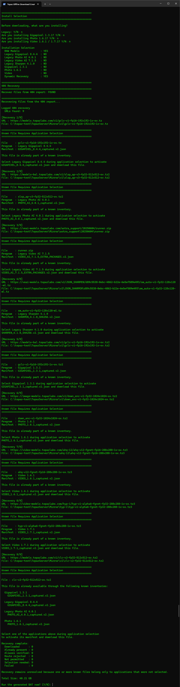
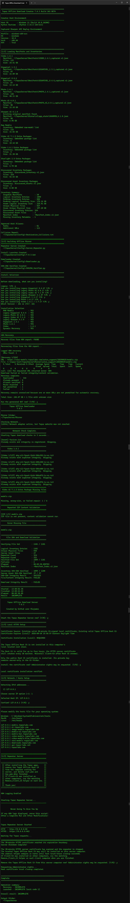

### Optional Tool — Topaz Discovery Integrated Offline + Online v0.63

**This tool is completely optional and is NOT required to use Topaz Offline Download Creator.**

A separate companion research utility that preserves historical model URL discoveries, including over **209,000 HTTP 206, 403, and 404 observations** across four CSV datasets.

Users can review previously tested URLs, compare reported file sizes, and export HTTP 206 URLs into `Topaz_Offline_Download_Creator_Error_206.txt`.

**Usage:**
```powershell
python Topaz_Discovery_Integrated_Offline_Online_v0.63.py --help
```

The utility operates independently and does not affect the Creator's normal functionality.

7,598 unique file paths + 4,658 alternate-domain links = 12,256 distinct HTTP 206 URLs.

Approximately 323.76 GB

**Development may be coming to an end, but the purpose of this project remains: preserving access to resources for the future.**

---

Building upon the substantial improvements introduced in **v7.0.3**, including application/version selection, expanded AI model inventories, SHA-256 integrity verification, and enhanced recovery mechanisms, this release aims to bring the project to a more complete and polished state.

What originally began as a personal side project has grown into a much larger undertaking, involving extensive research, reverse engineering, development, testing, and preservation of resources across multiple generations of Topaz applications.

Over time, the project has evolved beyond simply downloading AI models into a comprehensive offline preservation and restoration solution.

With **v7.0.4a Optional Tool**, I intend to bring this chapter of active development to a close and shift my focus toward other projects and interests.

My goal for this final major release is to leave behind a stable, well-documented, and useful tool for anyone who values offline accessibility, software preservation, and the ability to restore supported Topaz resources without repeatedly depending on their original download sources.

### A Final Personal Note

This project began with a simple challenge.

A friend once bet me that something like this couldn't be done. I accepted that challenge, not because I knew exactly how to accomplish it, but because they wanted to find out whether it was truly impossible.

What followed was countless hours of research, experimentation, reverse engineering, trial and error, and a determination to keep going whenever something didn't work.

What started as a bet eventually became something much bigger than I originally imagined.

And now, as I prepare to close this chapter and move on to other projects, I can look back and say that the challenge was worth accepting.

**Sometimes, the only way to find out whether something is impossible is to try.**

**The challenge was simple: make the impossible possible.**

---

**This README is the short project overview.** The project Wiki provides detailed setup, architecture, inventory, recovery, certificates, and testing documentation.

---

# Topaz Offline Download Server

The **Topaz Offline Download Server** is a local **HTTP/HTTPS resource mirror** for supported versions of **Topaz Photo, Gigapixel, Video, Photo AI, and Sharpen AI**, including captured AI models, GPU packages, metadata, and support files.

Rather than serving an ordinary folder of downloads, it recreates approved **hostnames and URL paths** that supported applications expect. Once the repository is prepared and verified, those resources can be served locally—reducing repeated Internet downloads and helping preserve access if original download locations change or disappear.

Designed for **offline installations, workstation rebuilds, custom Windows deployments, and long-term software preservation**. It handles captured resource delivery, not product activation, accounts, or cloud-dependent services.

---

## Features

- **Selective application installs:** Choose supported current and legacy Topaz versions instead of downloading the entire preserved inventory.
- **Local HTTP/HTTPS mirror:** Recreate approved Topaz hostnames and URL paths with exact route ownership and protocol rules.
- **Coordinated cross-platform tools:** Generate matched Downloader, SHA-256 Verifier, Repeater, manifests, and launchers for Windows, macOS, and Linux.
- **Verified inventory:** Preserve authoritative Manifest V2 metadata and check expected file sizes and SHA-256 hashes independently of download success.
- **Supplemental package checks:** Validate ZIP structure, contents, and CRC where authoritative SHA-256 metadata is unavailable.
- **Safe large-file transfers:** Resume interrupted `.part` downloads only under validated continuation rules, without mixing HTTP partial data into HTTPS replacements.
- **Controlled upstream recovery:** Retrieve from approved HTTPS sources and eligible alternate routes without weakening integrity requirements.
- **Error.txt reporting and repair:** Detect missing, corrupt, incomplete, or unavailable resources and attempt recovery only for permitted requests.
- **Discovery and provenance:** Track new inventory and support assets, recording recovered URLs, mirror paths, sizes, SHA-256 values, and source history.
- **Managed local certificates:** Use a local Root CA, rotating server certificates, and Client-CA installation/removal helpers.
- **Preservation and self-tests:** Retain captured resources and route history, with built-in checks for routing, recovery, certificate handling, generated programs, and determinism.
  
---

## Installation Time

**Offline estimate:** approximately 13+ minutes

**Online estimate:** approximately 20–45 minutes

Actual time depends on storage performance, network speed, file verification, certificate setup, selected applications, and the amount of inventory that needs to be downloaded.

---

## Repository Statistics

**Supported platforms:** Windows, macOS, Linux  
**Tested GPU:** NVIDIA GeForce RTX 5090

### Captured Application Inventory

| Application / Package | Logical Entries |
|---|---:|
| **Current Applications** | |
| Video 1.6.1 | 163 |
| Video 1.7.1 (includes Starlight 2.6) | 332 |
| Photo 1.6.1 | 126 |
| Gigapixel 1.3.1 | 97 |
| **Legacy Applications** | |
| Video AI 3.1.8 | 2,041 |
| Gigapixel 5.5.2 | 96 |
| Gigapixel 8.4.4 | 87 |
| Photo AI 4.0.1 | 98 |
| Sharpen AI 4.1.0 | 98 |
| **Shared and Optional Models** | |
| Raw Models (mandatory) | 132 |
| 'Research Future Findings (RAM)' | '7,598+' |
| RAW Algorithm Models (optional) | < 1,004 |
| **Supplemental Packages** | |
| Video 1.6.1 Extra Packages | 5 |
| Starlight 2.5 Extra Packages | 1 |
| Video AI 7.1.5 Extra Packages | 6 |

**Gigapixel 5.5.2:** An additional 24 restricted reference candidates are preserved separately, bringing its recorded references to 120. These candidates are excluded from the authoritative inventory totals.

### Inventory Totals

| Inventory Metric | Total |
|---|---:|
| Snapshot Manifests | **14** |
| Logical Inventory Entries | **4,286** |
| Unique Physical Files / Paths | **4,113** |
| Known Logical Inventory Size | **454.17 GB** |
| Known Unique Physical Size | **414.64 GB** |
| Missing Authoritative Inventory Metadata | 1 |

### Probing and Additional Routes

| Metric | Total |
|---|---:|
| Probing Inventory Entries | 1,976 |
| Probing Logical Inventory Size | 276.85 GB |
| Approved Host Alias Paths | 81 |
| Additional URLs | 111 |

**Logical versus physical:** Multiple captured application requests can refer to the same physical file. Probing and alias records describe additional route coverage and should not be treated as additional verified physical files.

The full inventory is preserved as project reference data, while installation selection determines which application groups are downloaded for an individual setup.

### Known Unavailable Package

One captured Video AI package remains unavailable from known approved upstream sources and lacks authoritative size and SHA-256 metadata:

`astra_support/20250825/models.zip`

Its original download route remains preserved for future recovery. No missing metadata is invented, and no unverified replacement file is treated as authoritative.

---

## Integrity Model

Validation depends on the evidence available for each resource. An authoritative expected SHA-256 provides a stronger byte-identity check than a hash calculated only after recovery.

### Recovery Integrity

Eligible newly discovered resources are retrieved from approved HTTPS sources and validated before being added to the repository. Accepted recovery records preserve the **source URL, mirror path, measured size, SHA-256, and provenance**.

The SHA-256 calculated for a newly discovered file identifies its recovered bytes; it does not, by itself, establish an authoritative vendor hash. Recovered ZIP archives must also pass applicable structure, member-content, and CRC checks.

### Supplemental Inventory Integrity

Captured packages without authoritative V2 SHA-256 metadata remain tracked separately. The project applies whichever checks are supported by the available evidence, including **file presence, known byte size, and ZIP content/CRC validation**.

A package that cannot be validated is not presented as SHA-256 verified, and missing expected metadata is not invented.

### Manifest V2 Integrity

Authoritative inventory records use:

- Exact URL
- Exact mirror path
- Exact expected byte size
- SHA-256

These records are verified by the generated SHA-256 Verifier and used as the authoritative offline inventory.

---

## Intended Uses

- **Offline installation and restoration:** Reuse preserved Topaz models and support resources without downloading them again.
- **System deployments and rebuilds:** Prepare Windows OOBE/Sysprep images and restore workstations.
- **Long-term preservation:** Archive current and legacy Topaz assets and recover eligible previously captured resources when approved sources remain available.

---

## Capture Method

The inventory was assembled by observing Topaz applications and installers during controlled installation and download testing. Evidence includes **application logs and state data, HTTP/HTTPS requests and download URLs, file-system activity, and model metadata**.

Captured **hosts, protocols, URL paths, file sizes, and available hash information** are preserved with their resource records. Files with similar names are not assumed to be identical.

---

## Goal

Preserve the resources and request information needed to reinstall and restore supported Topaz applications, even if their original download locations change or disappear.

**Upstream availability does not determine historical inventory membership.** Legitimately captured resource routes and metadata remain documented even when the original files are unavailable. Missing metadata is not invented, and unofficial replacements are never treated as original Topaz assets.

---

## Version 7.0.3

**Version 7.0.3 (Build 263)** is the current matched release of the Creator and its generated Downloader, Verifier, Repeater, and support files. Its expanded application coverage, inventory, installation selection, integrity safeguards, recovery improvements, and local HTTPS capabilities are summarized in the sections above.

**Validation:** Build 263 completed the consolidated self-test successfully on **Windows and Linux**. The reported results do not imply that every supported application feature or platform configuration has been tested.

**Release history:** Version 7.0.0 introduced the major architectural rebuild from 6.2.0. Detailed implementation changes and test coverage are documented in the project Wiki and changelog.

---

## Local Access

Access through `localhost` or a direct IP address is intentionally disabled while the server is running.

This behavior is by design and there is no setting, toggle, or on/off switch to enable it.

---

Download Selection results

2nd picture below is a normal flow run.






Version 1.0.0 - Installing Topaz Video 1.6.1, Topaz Photo 1.6.1, & Topaz GigaPixel 1.3.1 under 13 mins


